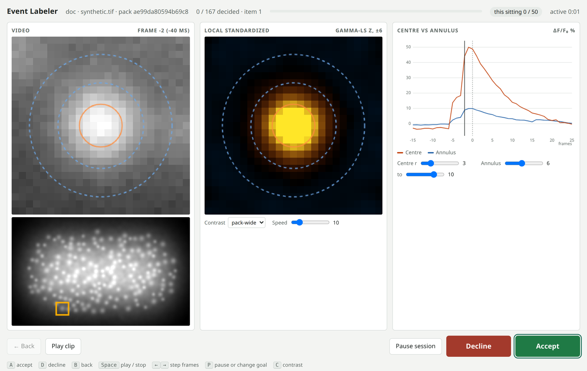
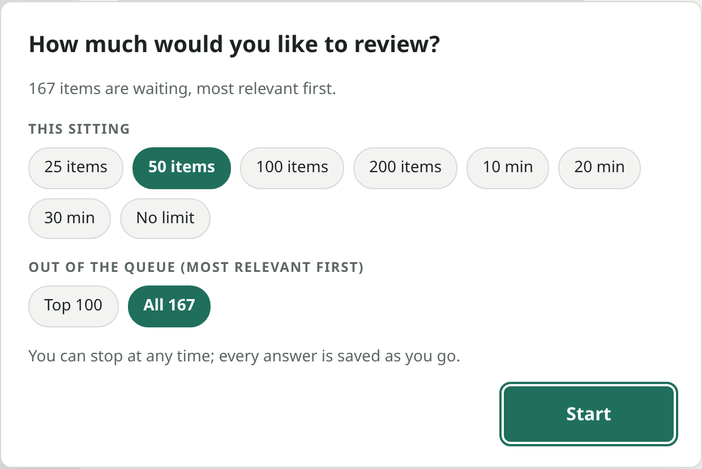

<h1 align="center">Event labeler</h1>

<p align="center">
  <strong>Label calcium events by reviewing a short ranked list of candidates, not every pixel of every frame.</strong><br>
  A detector proposes. A person decides, one short clip at a time. Every answer is saved the moment it is given.
</p>

<p align="center">
  <picture>
    <source media="(prefers-color-scheme: dark)" srcset="docs/labeler-dark.png">
    
  </picture>
  <br><sub>A synthetic recording, shown as a labeller sees it.</sub>
</p>

<p align="center">
  <a href="https://www.raulv.dev/neurev/review/"><strong>Open NeuRev Review</strong></a> ·
  <a href="#label-a-pack">Label a pack</a> ·
  <a href="#build-a-pack">Build a pack</a> ·
  <a href="#walkthrough-spon-ca-burst">Spon Ca Burst walkthrough</a> ·
  <a href="#any-recording">Any recording</a> ·
  <a href="#read-the-results">Results</a> ·
  <a href="#troubleshooting">Troubleshooting</a>
</p>

---

## Why

Scanning a recording for events means inspecting every pixel of every frame, R × C × T values, by eye. The
labeler turns that into a queue. The P1-phys detector ranks candidate events, most relevant first, and a person
answers **Accept** or **Decline** for each one, usually in a few seconds.

Three things set it apart from a plain viewer:

- **The queue includes blinded controls.**
  - Random patches show what the detector misses.
  - Optional reference annotations, hidden among the top items, show whether people find known events again.
  - Labellers cannot tell any of these apart from ordinary candidates.
- **Nothing is lost.** Every answer is written to disk immediately. Close the window at any time and continue
  later.
- **The review itself is data.** Each answer carries a record of how it was made: time on the item, frames
  viewed, replays and display changes. That record can be studied later.

> [!NOTE]
> **On Spon Ca Burst**, within the frames that have reference annotations:
> - The top 72 candidates, about 4% of a clip-by-clip review, reached 34 of 76 reference events.
> - The top 177, about 9%, reached 43.
> - The detector's ceiling is about 51 of 76.
>
> These figures are descriptive: those annotations have been used many times. The labeler is built to measure
> this properly, with fresh labellers.

## How it works

<p align="center">
  
</p>

| | Role | Does | Needs |
|---|---|---|---|
| 🧰 | **Pack builder** | Runs the detector on a recording, gives out the **pack**, keeps the **key**, and summarizes the logs. | This repository, Python ≥ 3.9 and three packages |
| 👀 | **Labeller** | Opens the pack in a browser, decides each item, and sends back one results file. | A web browser (or Python ≥ 3.8 for the local server) |

> [!IMPORTANT]
> **The builder of a pack must not label it.** The key says which items are controls and which are hidden
> reference annotations. The test only works if the labellers do not know.

---

## Label a pack

There are two ways to review a pack. Both use the same screen and record the same things.

**In a browser: nothing to install.**
1. Open **[NeuRev Review](https://www.raulv.dev/neurev/review/)**.
2. Enter your name and your experience with calcium imaging, then choose the pack `.zip` you were sent.
3. Review. Answers are saved in your browser, so you can close the tab and come back later in the same browser.
4. Press **Download results** and send the zip back.

Nothing is uploaded: the pack is read on your own computer. The same page also works offline: open
`labeler.html` from the pack folder directly.

<details>
<summary><strong>With the local server (Python)</strong></summary>

Open a terminal **inside the pack folder** and run:

```bash
python3 label_server.py . --annotator YOURNAME
```

<sub>On Windows: <code>py label_server.py . --annotator YOURNAME</code>. Always use the same name.</sub>

Answers go to `labels_<pack id>_YOURNAME.jsonl` in the pack folder; send that file back.
</details>

### Choose how much to review

The page opens by asking how much you have time for. Nobody has to get through the whole queue.

<p align="center">
  <picture>
    <source media="(prefers-color-scheme: dark)" srcset="docs/setup-dark.png">
    
  </picture>
</p>

| Choice | Options | What happens |
|---|---|---|
| **This sitting** | 25 · 50 · 100 · 200 items, 10 · 20 · 30 min, or no limit | A counter in the header tracks the goal. When it is reached you choose **Keep going** or **Finish for now**. Finishing tells you exactly where you will resume. |
| **Out of the queue** | Top 100 · 200 · 300, or all | The queue is ranked, so the top of it matters most. When the chosen part is done you can widen it by 100 or stop. |

Press <kbd>P</kbd> at any time to pause or to change the goal. The pack builder can suggest defaults when
starting the server, for example `--budget 50`, `--minutes 20` or `--scope 200`.

### What you see

| Panel | Shows | Look for |
|---|---|---|
| **Video** | The raw recording around the candidate: 25 × 25 px and 0.8 s (15 frames before, 25 after), looping. The small brain image marks where the clip is. | A spot at the centre that brightens and fades. |
| **Local standardized** | The same clip after Gamma-LS standardization: each pixel's change compared with the ring of tissue around it. Orange is brighter than its surroundings, blue is darker. | An orange flash at the centre as the event begins. |
| **Centre vs annulus** | ΔF/F₀ inside the orange circle and in the ring between the dashed circles. The dashed line is the item's frame. | The centre rising well above the annulus, then decaying. |

**Accept** when a cell at the centre lights up. **Decline** anything else: noise, flicker, movement, or a
brightening of the whole area. **Unsure** is a real answer too; add a short **note** (<kbd>N</kbd>) whenever
something is worth saying.

### Keys

| Key | Action | | Key | Action |
|:---:|---|---|:---:|---|
| <kbd>A</kbd> | Accept | | <kbd>Space</kbd> | Play or stop the clip |
| <kbd>D</kbd> | Decline | | <kbd>←</kbd> <kbd>→</kbd> | Step one frame |
| <kbd>U</kbd> | Unsure | | <kbd>N</kbd> | Type a note (<kbd>Esc</kbd> to leave the box) |
| <kbd>B</kbd> | Back, to change an answer | | <kbd>C</kbd> | Contrast: pack-wide or this clip |
| <kbd>P</kbd> | Pause, or change the goal | | | The ring sizes are sliders under the traces |

> [!TIP]
> **To stop,** just close the tab (or, with the local server, press <kbd>Ctrl</kbd>+<kbd>C</kbd> in the
> terminal). Opening it again carries on exactly where you left off.

---

## Build a pack

### Install

```bash
git clone https://github.com/Jibby2k1/NeuRev-Workbench.git
cd NeuRev-Workbench
python3 -m venv .venv-labeler
source .venv-labeler/bin/activate
pip install -r neurobench/tools/event_labeler/requirements.txt     # numpy, scipy, tifffile
```

<details>
<summary><strong>Windows</strong></summary>

```powershell
py -m venv .venv-labeler
.venv-labeler\Scripts\activate
pip install -r neurobench/tools/event_labeler/requirements.txt
```
</details>

<details>
<summary><strong>Ubuntu / Debian: "ensurepip is not available"</strong></summary>

Install the venv module with `sudo apt install python3-venv`, or use [uv](https://docs.astral.sh/uv/) instead:

```bash
uv venv .venv-labeler && source .venv-labeler/bin/activate
uv pip install -r neurobench/tools/event_labeler/requirements.txt
```
</details>

<details>
<summary><strong>Check the install (optional)</strong></summary>

```bash
pip install pytest
python -m pytest tests/test_event_labeler.py
```

This builds a pack from a small synthetic movie and checks that the planted events are among the top proposals,
then checks that answers are saved and that a session resumes.
</details>

The labeler runs from its own folder. It does not need the rest of `neurobench`, which installs heavier
dependencies.

---

## Walkthrough: Spon Ca Burst

Both files are in the lab's shared `NeuRev-Workbench` folder, under `Inputs/Spon Ca Burst/`:

| File | What it is |
|---|---|
| `3 hindbrain to tail 488 20ms.tif` | The recording: 2359 frames, 340 × 573 px, 50 Hz |
| `labels/labels_normalized.tsv` | The reference annotations: 79 cells across 4 bursts |

**1 · Build** (about 2 minutes)

```bash
python neurobench/tools/event_labeler/build_pack.py --preset spon \
    --tif "PATH/TO/Inputs/Spon Ca Burst/3 hindbrain to tail 488 20ms.tif" \
    --annotations "PATH/TO/Inputs/Spon Ca Burst/labels/labels_normalized.tsv" \
    --reviewers "Reviewer One" "Reviewer Two" --label "Spon Ca Burst" \
    --out packs/spon --zip
```

You get:

```text
packs/spon/                     ← the pack folder
packs/spon.zip                  ← the same pack zipped (--zip): give this out
packs/spon_KEY_DO_NOT_SHARE/    ← the key: keep it
```

The pack holds **699 items**:

| Items | What they are | Where in the queue |
|---:|---|---|
| 600 | Detector proposals | Ranked, most relevant first |
| 67 | Random control patches, from the same periods but away from every event | Random positions |
| 32 | Reference annotations the detector did not already propose | Random positions within the first 300 |

The other 47 reference annotations already have a proposal within 6 px inside their burst. The key records which
proposal covers each one.

**2 · Share.** Send `packs/spon.zip` (or put it in the shared folder) together with the link
<https://www.raulv.dev/neurev/review/>. Never include the key.

**3 · Label.** Each labeller follows [Label a pack](#label-a-pack). The same guide ships inside the pack as
`LABELLING.md`.

**4 · Summarize.** Collect the results zips (or `.jsonl` logs from the local server) and run:

```bash
python neurobench/tools/event_labeler/summarize.py \
    --key packs/spon_KEY_DO_NOT_SHARE/key.json  neurev_review_*.zip labels_*.jsonl
```

---

> [!TIP]
> **A demo pack for showing the tool live:** five clear events from five different cells, with no controls.
> ```bash
> python neurobench/tools/event_labeler/build_pack.py --preset spon --tif "…/3 hindbrain to tail 488 20ms.tif" \
>     --max-proposals 5 --random-frac 0 --dedupe-px 25 --dedupe-frames 5000 --exclude-saturated \
>     --label "Spon Ca Burst demo" --out packs/spon_demo --zip
> ```

## Any recording

```bash
python neurobench/tools/event_labeler/build_pack.py --tif MOVIE.tif --out packs/movie
```

Without a preset, the whole frame is reviewed. The first 200 frames warm the detector up, and the noise
calibration is fitted on the next 200.

| Option | Default | Meaning |
|---|---|---|
| `--annotations FILE` | none | Reference annotations to hide in the queue (format below) |
| `--annotation-window N` | 300 | Hidden annotations go within the first N items |
| `--region Y X H W` | whole frame | Restrict the area that is reviewed |
| `--warmup N` | 200 | Frames used to warm the detector up |
| `--setup FIRST LAST` | the 200 after warm-up | Frames for the noise calibration; pick a quiet stretch if you can |
| `--photon A B` | fitted | A known noise line, var = A · mean + B |
| `--max-proposals N` | 600 | Number of detector proposals |
| `--random-frac F` | 0.10 | Share of the queue that is control patches |
| `--z-min Z` | 4.0 | Detector threshold for an event |
| `--half H` · `--pre N` · `--post N` | 12 · 15 · 25 | Clip size 2H+1 px, frames before and after |
| `--fps F` | 50 | Frame rate, used only for display |
| `--zip` | off | Also write `<out>.zip`, ready to send |
| `--reviewers NAME …` | none | Names offered as choices when the pack is opened (stored in the pack, not on any website) |
| `--label TEXT` | file name | Short name shown for the pack, e.g. `"Spon Ca Burst"` |
| `--exclude-saturated` | off | Skip proposals next to saturated pixels (useful for a clean demo pack) |
| `--first-ui N` | 1 | Frame number of the TIFF's first frame |
| `--key-out DIR` | `<out>_KEY_DO_NOT_SHARE` | Where the key goes; never inside the pack |

**Annotation file:** tab-separated, with a header row. Coordinates are full-frame pixels; frames are 1-based.

```text
x_px    y_px    start_frame_ui    end_frame_ui    roi_identity    burst_id
120.0   85.5    400               460             cell_A          1
```

`roi_identity` and `burst_id` are optional. Each hidden annotation is shown at the frame in its window where its
centre is brightest.

> [!NOTE]
> The input must be one T × H × W TIFF stack. Convert other formats first, for example with Fiji:
> *File → Save As → Tiff*.

---

## Read the results

Each reviewer's **results zip** holds:

| File | Content |
|---|---|
| `labels_<pack>_<name>.jsonl` | The complete log: every answer, note and review record (same format as the local server's log) |
| `decisions.csv` | One row per decided item: position, frame, location, answer, note, seconds |
| `summary.txt` | Counts, sittings and median time per decision, readable at a glance |
| `reviewer.json` | Name and stated experience |

`summarize.py` prints a block per labeller:

```text
== NAME: <decisions> decisions in <n> sittings (<g> session goals reached; scope: top <N> | whole queue)
  annotation                     <accepted> / <decided> accepted (<rate>)
  proposal                       <accepted> / <decided> accepted (<rate>), <n> unsure
  proposal_covering_annotation   ...
  random                         ...
  reference annotations re-accepted: <accepted> / <decided>
  seconds per decision: median <s>, mean <s>; <n> decisions per active hour
  proposal accept rate by queue block: {'1-100': ..., '101-200': ...}
```

| Line | Read it as |
|---|---|
| `proposal` | How many candidates people judge to be real events |
| `random` | Events the detector **missed**: accepted control patches are real misses |
| `annotation`, `reference annotations re-accepted` | Whether known events are found again when nobody says which they are |
| `seconds per decision` | Review speed, with paused and hidden time excluded |
| `by queue block` | How the accept rate falls with rank, i.e. where reviewing stops paying off |

Add `--json report.json` for a machine-readable copy.

<details>
<summary><strong>What each log line records</strong></summary>

`labels_<pack id>_<name>.jsonl` has one JSON object per line and is only ever appended to.

**Decision lines** hold the answer plus a `process` record:

- **Timing:** active, paused and hidden time on the item, and time to the first interaction.
- **Viewing:** `dwell_ms`, the time spent on each of the 41 frames, plus loops played, frame steps and play/stop
  presses.
- **Display changes:** every ring, contrast and speed change, with its time, and the display at the start and at
  the decision.
- **Navigation:** keyboard or mouse, and whether the item was revisited and what the earlier answer was.

**Other lines:**

- **Session start:** the browser name, screen size, and hashes of the tool files.
- **Pause, resume, back and stop:** the session timeline.
- **Settings and goals:** every goal and scope choice, and each goal reached, with that sitting's decisions and
  active time.

The log holds nothing else from the labeller's computer. A log is tied to one pack and cannot be resumed against
another.
</details>

---

## Reference

<details>
<summary><strong>Files in a pack, and in the key</strong></summary>

| File | Content |
|---|---|
| `manifest.json` | Item positions (frame, y, x) in queue order, clip geometry and display ranges. It holds no item kinds and no scores. |
| `raw.u16`, `ls.i16` | The clips: raw counts, and Gamma-LS z × 100 (little-endian) |
| `context.u8` | The mean image used for the location map |
| `label_server.py`, `labeler.html`, `LABELLING.md` | The review app and the labeller guide |

The key folder holds `key.json`: each item's kind (proposal, random or annotation), detector score, queue position
and covered annotations, plus every annotation's outcome and the build settings. It also holds `build.log`.
</details>

<details>
<summary><strong>The detector, and its parity with the research code</strong></summary>

`operators.py` holds standalone ports, numpy and scipy only, of the NeuRev three-part prescreener operators:

| Operator | Definition |
|---|---|
| **P1-phys** (arm A5) | Gaussian blur σ 3.24 px. Fast EMA 0.4 minus lagged EMA 0.141, divided by the photon-noise SD √(c_t · g² ⊛ max(a·μ + b, 1)), where μ is a raw EMA at rate 0.02. |
| **Gamma-LS** (arm A1) | The one-frame change of EMA 0.4 levels of a σ 1 blur, standardized by a Gamma ring (guard 7, half-width 15, shape 9, mode 7.5). The floor is the 10th percentile of the setup spread. |
| **Candidates** | 13 × 13 local maxima, 6 px border, greater than 6 px separation, strict > 0 |
| **Events** | Candidate rows above `--z-min`, linked across ≤ 6 px and ≤ 2 frames; one item per event at its peak |
| **Noise line** | var(Yₜ − Yₜ₋₁) / 2 against the mean over the setup frames, in 40 equal-count bins, OLS fit |

Parity against the original implementation, on all 2359 Spon Ca Burst frames:

- **P1-phys scores:** bit-identical.
- **Candidate rows:** all 397,775 identical.
- **Gamma-LS z:** at most 1.2 × 10⁻¹³ apart.
- **Gamma-LS floor:** identical.

The Spon preset uses the calibrated noise line 3.578 · μ − 303.4. The automatic fit on that recording's whole
frame gives about 3.73 · μ − 408.
</details>

<details>
<summary><strong>Building the same pack twice</strong></summary>

Builds are deterministic for a given recording, annotation file and settings (`--seed`). Rebuilding the Spon
pack from a fresh clone reproduced the same pack id and byte-identical clips.
</details>

---

## Troubleshooting

<details>
<summary><strong>Server options</strong></summary>

| Option | Meaning |
|---|---|
| `--annotator NAME` | Who is labelling; it names the log file |
| `--port N` | Port, 8765 by default |
| `--log-dir DIR` | Where the log goes, the pack folder by default |
| `--budget N` · `--minutes M` · `--scope N` | Preselect the sitting goal and the queue scope |
| `--export FILE.tsv` | Write the decisions as a table and exit |
| `--no-browser` | Don't open a browser |
</details>

<details>
<summary><strong>"Address already in use"</strong></summary>

Another program is using port 8765. Pick another port: `--port 8766`. Two labellers on one computer each need
their own port.
</details>

<details>
<summary><strong>The browser did not open</strong></summary>

Open the address the terminal prints, `http://127.0.0.1:8765/` by default, in any browser.
</details>

<details>
<summary><strong>"belongs to pack …, refusing to mix packs"</strong></summary>

That log file was written for a different pack. Use the pack it came from, or a different `--annotator` name or
`--log-dir`.
</details>

<details>
<summary><strong>"setup frames … are outside the recording"</strong></summary>

The recording is shorter than warm-up plus setup (400 frames by default). Lower `--warmup` or give `--setup`
explicitly.
</details>

> [!CAUTION]
> Recordings, packs, keys and logs are lab data. Keep them out of this repository.
